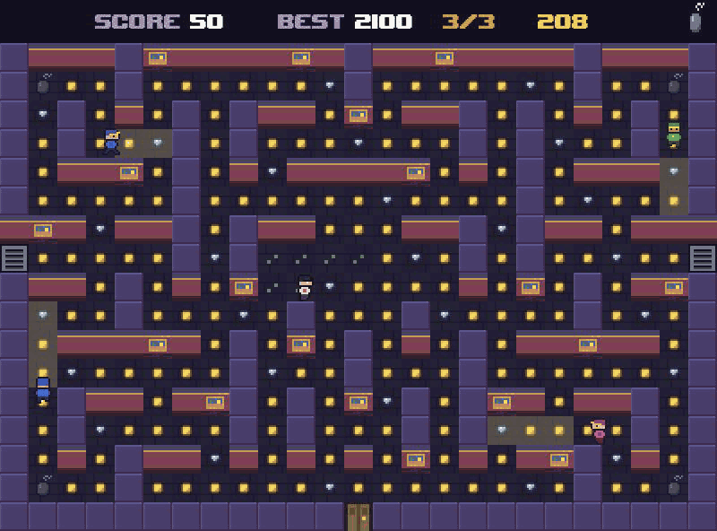
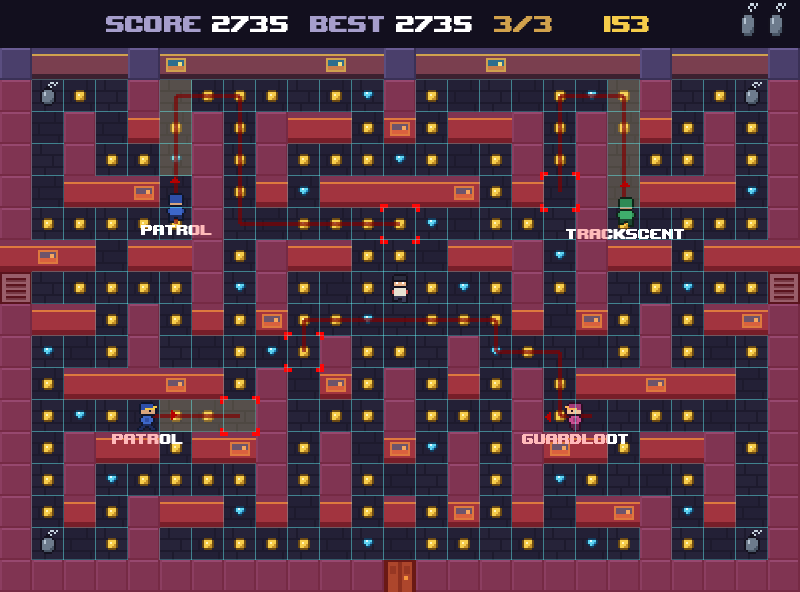
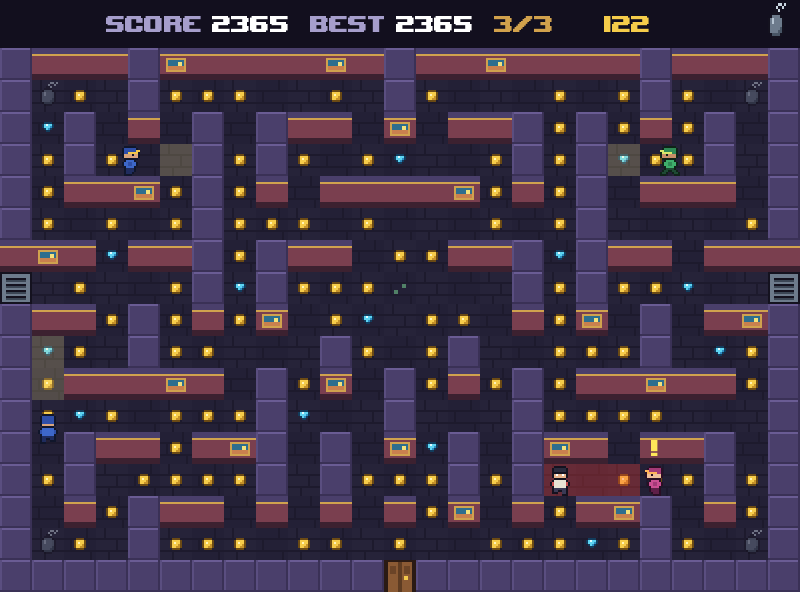

# Night Heist

A short stealth game in a maze, made with Godot 4.7. You're a burglar in a museum at night: empty three
rooms of their loot, then leave through the door without getting caught.

It started as the maze chase of the [20 Games Challenge](https://20_games_challenge.gitlab.io/). I turned
it into a stealth game, where the guards have to see you before they come after you, and they are the
part I spent the most time on.

**Play it in your browser: https://kozumagames.itch.io/night-heist**



## How to play

Take every coin and gem in the room. The door at the bottom only opens once the room is empty. If a
guard catches you, everyone goes back to their spot but what you took stays taken.

- Stay out of the flashlights. A guard also notices you if you walk right next to him, even from behind.
- A smoke bomb stuns the guards inside the cloud and wipes your footprints around it. You start with one
  and pick up more in the corners of the room, three at most.
- The vents on the sides take you to the other side of the room. Guards can't follow you through them.
- You have 3 lives. Leaving a room gives you one back, and leaving it without being seen gives a bonus.

| Key | Does |
| --- | --- |
| Arrows or WASD | move |
| Space or E | throw a smoke bomb |
| Esc or P | pause, then R to go back to the title |
| Tab | debug menu |
| F3 | show where the guards are going |

WASD are read by position on the keyboard, so on AZERTY it's ZQSD. The best score is saved.

## The guards



There are three kinds, and the rooms add one each:

- **Patroller** (blue): walks a route.
- **Tracker** (green): follows your footprints, step by step. A vent or a smoke bomb breaks the trail.
- **Warden** (pink): stays near the part of the room with the most loot left, then watches the door once
  it's all gone.

When one of them sees you he chases you, keeps going for a moment after losing sight of you, then searches
the spot where you were before going back to what he was doing. From the second room on, a guard who spots
you calls the others close enough to help.

How it works:

- Each guard has a `GuardBrain` node whose children are its behaviors (`Patrol`, `Chase`, `Search`,
  `Stunned`...), one short script each. The brain runs one at a time. The three kinds of guard are
  instances of the same scene, with their own colour, speed and the behavior they come back to.
- A behavior only picks a target cell. `PathFollowComponent` asks an `AStarGrid2D` for the way on every new
  tile, and `MovementComponent` does the walking, the same one as the thief.
- Vision doesn't use physics. A cell is seen when it's in a cone in front of the guard and a line across the
  grid reaches it without hitting a wall. The light you see on screen is exactly what the guard sees.
- The Tracker reads a map of when you walked on each cell, the Warden counts the loot around each cell.
  Neither of them knows where you are.

The debug menu (Tab) is in the released game too: jump between rooms, spawn or remove guards, walk through
walls, slow time down, change every difficulty setting while playing, show the paths or the A* grid.



## Running it

Open `project.godot` with [Godot 4.7](https://godotengine.org/download/) and press F5.

The tests start the real rooms without a window and check the guards, the door, the vents, the debug menu
and a whole game won and lost:

```
godot --headless --path . tests/ai_test.tscn
```

The `Web` export preset writes to `exports/web/`. It doesn't use threads, so it runs on itch.io without
any special setting. `tools/push_itch.bat` runs the tests, exports and uploads the build with
[butler](https://itch.io/docs/butler/).

## Layout

One folder per thing in the game, with its scenes, scripts, data and images together. A file used by two
of them goes with what it is: the character sheet is in `characters/`, the props sheet in `levels/`.

- `characters/`: the thief, the guards, their behaviors and their animations
- `components/`: the small nodes the thief and the guards are built from (movement, path following,
  vision, catching, pickups, smoke bombs)
- `levels/`: the three rooms (`TileMapLayer` nodes you can edit in the editor), the door, the vents,
  the smoke cloud, and the difficulty of each room in `levels/difficulty/`
- `game/`: the game loop, the score and the music that changes during a chase
- `interface/`: HUD, screens, and the debug menu with one node and one script per tab
- `audio/`: the sounds and the node that plays them
- `shared/`: the autoloads (signals, the grid of the current room, constants, debug settings)

## Credits

Art, sounds and maps were made for this game. The font is Upheaval TT by Brian Kent (Ænigma Fonts),
a free font he lets anyone redistribute.

The code is under the MIT license.
